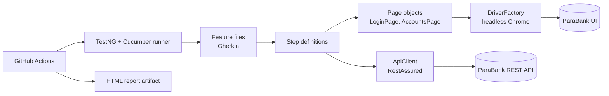

# ParaBank Test Automation Framework

[](https://github.com/Shital24650/parabank-selenium-cucumber-framework/actions/workflows/tests.yml)


A BDD test automation framework that tests a banking application through **both the UI and the REST API**, including an end-to-end check that the two agree. It runs on every push in GitHub Actions and publishes an HTML report.

**System under test:** [ParaBank](https://parabank.parasoft.com), Parasoft's public demo bank.

---

## What it tests

| Tag | Scenario | Layer |
|-----|----------|-------|
| `@smoke @ui` | Valid user lands on the Accounts Overview page | UI |
| `@ui` | Invalid credentials are rejected (error shown, no access) | UI |
| `@api` | REST login returns the customer (status 200, customer id) | API |
| `@e2e` | Account ids shown in the UI match the ids returned by the API | UI + API |

The end-to-end scenario logs in through the API, fetches the customer's accounts, logs in through the browser, reads the accounts table, and compares both sets.

---

## Architecture



**Design choices**
- **Page Object Model.** Locators and page actions live in `pages/`. Step definitions contain no locators.
- **Explicit waits only.** `WebDriverWait` with expected conditions. No `Thread.sleep`.
- **API-only scenarios skip the browser.** A tag-based hook (`not @api`) starts Chrome only when a scenario needs it.
- **Shared state per scenario.** `TestContext` is injected into step classes with PicoContainer, so scenarios never share data.
- **Failure screenshots.** A screenshot is attached to the Cucumber report whenever a scenario fails.
- **Config overrides.** Values in `config.properties` can be overridden from the command line.

---

## Tech stack

Java 17 · Selenium WebDriver · Cucumber (BDD) · TestNG · RestAssured · Maven · PicoContainer · GitHub Actions

---

## Project structure

```
.
├── .github/workflows/tests.yml        # CI pipeline
├── pom.xml
└── src/test
    ├── java
    │   ├── pages/                     # Page objects
    │   │   ├── LoginPage.java
    │   │   └── AccountsPage.java
    │   ├── steps/                     # Step definitions and hooks
    │   │   ├── Hooks.java
    │   │   ├── TestContext.java
    │   │   ├── UiSteps.java
    │   │   └── ApiSteps.java
    │   ├── utils/                     # Driver, config, REST client
    │   │   ├── DriverFactory.java
    │   │   ├── ConfigReader.java
    │   │   └── ApiClient.java
    │   └── runners/TestRunner.java
    └── resources
        ├── config.properties
        └── features/parabank.feature
```

---

## Running the tests

**Prerequisites:** JDK 17, Maven, Google Chrome.

```bash
# Run everything (headless)
mvn test

# Watch the browser
mvn test -Dheadless=false

# Run one layer by tag
mvn test -Dcucumber.filter.tags="@api"
mvn test -Dcucumber.filter.tags="@smoke"

# Point at another environment or user
mvn test -DbaseUrl=https://your-host/parabank -Dusername=john -Dpassword=demo
```

The report is written to `target/cucumber-report.html`.

---

## CI/CD

The workflow in `.github/workflows/tests.yml`:
1. Checks out the code and sets up Java 17 with a Maven cache.
2. Runs `mvn -B test` against headless Chrome on a GitHub-hosted runner.
3. Uploads the Cucumber HTML report as a build artifact, even when the run fails.

It runs on every push and pull request, and can be started manually from the **Actions** tab.

---

## Sample report


---

## Engineering notes

- **Invalid-login assertion.** The first version asserted ParaBank's exact error text. The public instance returns a generic internal-error message for bad credentials, so the test failed in CI. It now asserts the behaviour that matters: an error is shown and the Accounts Overview is not reachable. Tests should verify behaviour, not copy wording from an environment I don't control.
- **Asynchronous table.** The accounts table is filled by a background request after login, so `AccountsPage` waits for the first account link instead of reading the table immediately.
- **Shared public environment.** ParaBank is a public demo, so data and availability can change. A timeout or 5xx means re-run before debugging.

---

## Roadmap

- [ ] More API coverage: transfers, bill pay, negative status codes
- [ ] Parallel execution
- [ ] AI-assisted failure summaries from the report
- [ ] Docker image for a one-command local run

---

## Author

**Shital Parab**
[LinkedIn](https://www.linkedin.com/in/shital-parab-054751300) · [GitHub](https://github.com/Shital24650)
